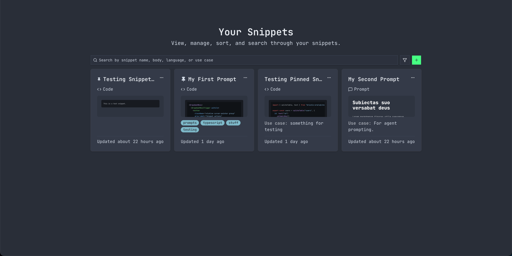
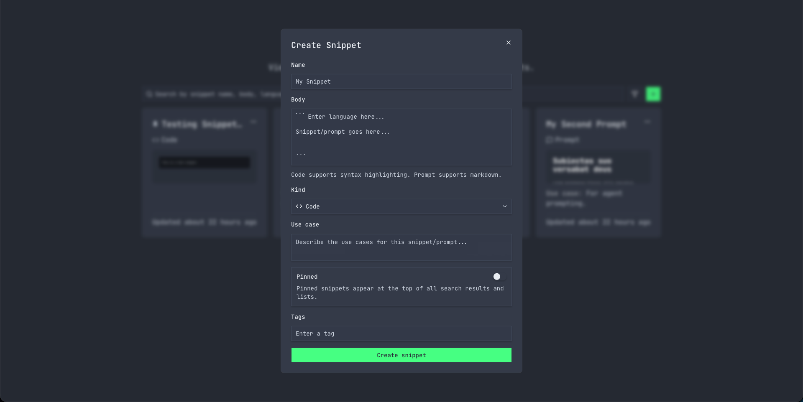
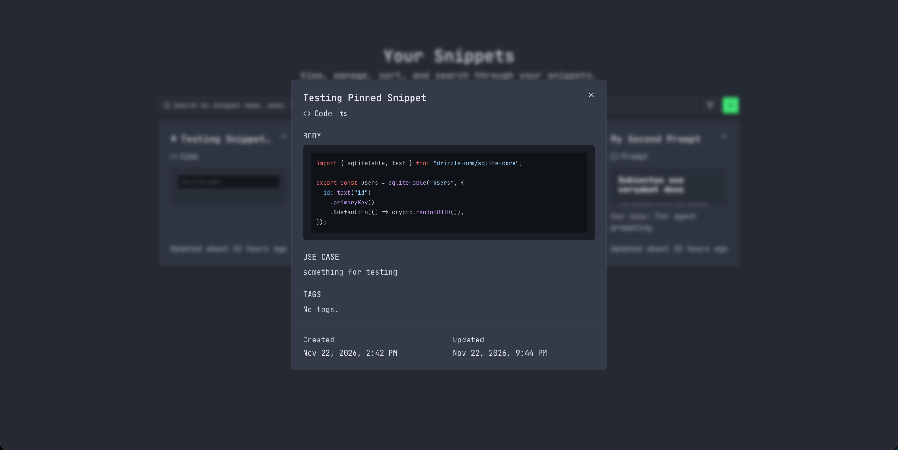

# Cue

A web application that allows you to store used snippets and prompts locally on your machine. You can manage, add, view different snippets and easily copy them with one click.

## Screenshots





## Why

I built this application because I frequently copy and revisit snippets from my old projects to use them in new projects. I wanted an easier way to manage and keep them in one place where I could easily retrieve them when needed. The hardest parts of the application to implement were the shared architecture and the snippet fetching logic.

## Features

- Manage different snippets and prompts
- Filter and sort to easily find snippets
- Detailed views that render the code snippet or markdown
- Hosted locally on your machine so nothing leaves your system

## Demo

Watch this video here to see the demo along with how to get things setup.


[Cue V1 Demo & Setup Video](https://www.youtube.com/watch?v=CzIn6G5mFkk)

## Tech Stack

- Turborepo for easy and fast monorepo development
- Next.js and React for the full-stack foundation
- TypeScript for clean, type-safe code on both the frontend and backend
- TailwindCSS and shadcn/ui for a clean, reusable design system
- Drizzle ORM and SQLite for the database
- React Hook Form for form management
- Zod for data validation across the stack
- T3-OSS for type-safe environment variables
- Zustand and React Context for global state management
- Tanstack React Pacer for debouncing
- PNPM as the package manager

## Try it out

Follow the installation instructions below or watch the video for a clear step-by-step guide + demo.

## Setup

1. Make sure that you have NodeJS, PNPM, and git installed. You can check the Next.js documentation to make sure that you have the current versions.
2. Clone the repo with the following command:
```bash
git clone https://github.com/Danieldkdao/cue.git
cd cue
```
3. OPTIONAL: You can update the path of the local database. This is optional and a default path is already set to `./data/cue.db`. To update the path, you can create a new `.env` file in the web app and set a `DATABASE_URL` environment variable to the new database path.
4. Setup the project with the following commands:
```bash
pnpm install
pnpm db:generate
pnpm db:migrate
```
5. Run the development server with:
```bash
pnpm dev
```
Then go to `http://localhost:3000` and explore the application.

## Credits

I planned the application and built it myself with no assistance from other people.

### AI Usage

I used AI to help me with researching and exploring different ideas and packages outside of the main development of the application. The initial idea, the planning, most of the research, and the complete implementation is my work.

## What's Next

Right now the application is just a web app. I plan to add this as an extention to Raycast so users can manage and add snippets from wherever they are on their computer. That is why the repository is a monorepo. I am currently working on this feature and hope to get the extension on the Raycast store soon. Feel free to reach out to me at danieldkdao@gmail.com if you have any ideas on how I could improve the application or if you just encountered a bug and want to report it.
